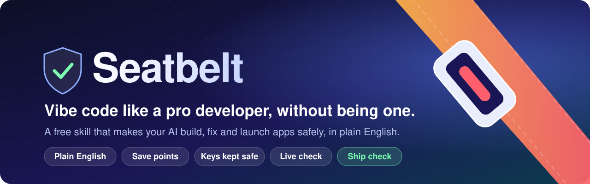
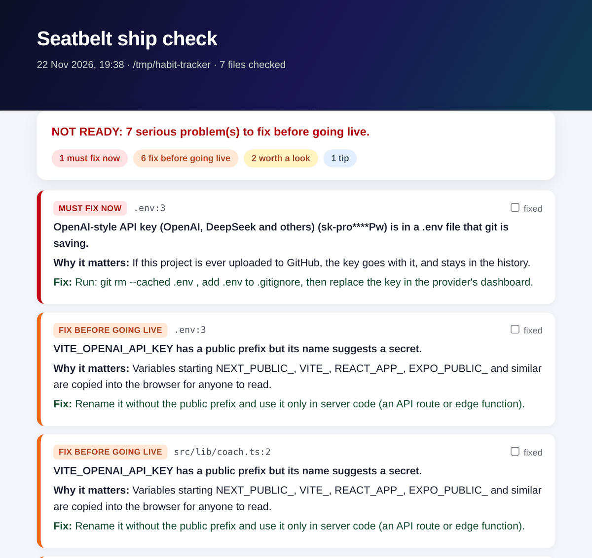
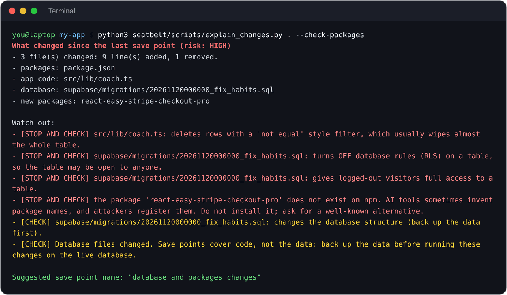
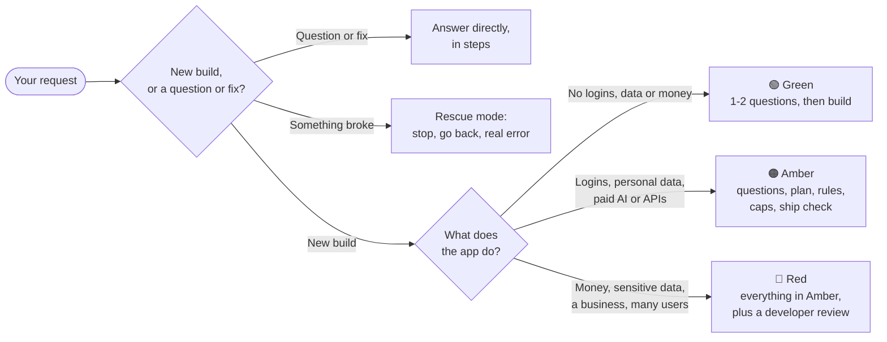
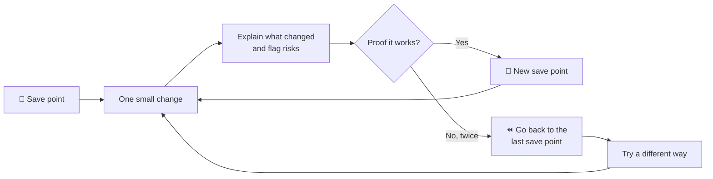
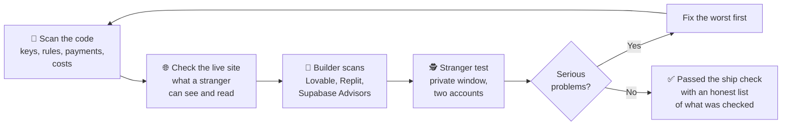

<p align="center">
  
</p>

<p align="center">
  <a href="https://github.com/HYDERMAA/seatbelt/releases/latest"></a>
  <a href="LICENSE"></a>
  
  <a href="https://agentskills.io"></a>
  
  
</p>

<p align="center">
  <b>A free skill that makes your AI build, fix and launch apps the way a careful professional would,<br>and explain everything in plain English while it does.</b>
</p>

<p align="center">
  <a href="#install-in-30-seconds">Install</a> &nbsp;&middot;&nbsp;
  <a href="#see-it-in-action">See it in action</a> &nbsp;&middot;&nbsp;
  <a href="#how-it-works">How it works</a> &nbsp;&middot;&nbsp;
  <a href="#whats-new-in-version-3">What's new</a> &nbsp;&middot;&nbsp;
  <a href="#faq">FAQ</a>
</p>

<br>

You do not need to know what git, an API key or a database policy is. **Seatbelt does.**

<br>

## Install in 30 seconds

Pick the tool you use. Every option is free.

| You use | Do this |
| --- | --- |
| **Claude.ai** (web or desktop) | Download [`seatbelt.zip`](https://github.com/HYDERMAA/seatbelt/releases/latest) (do not unzip it). Open **Plugins** in the sidebar (called **Customize** before November 2026) and upload the zip as a skill. Code execution must be on: **Settings > Capabilities**. [Anthropic's guide](https://support.claude.com/en/articles/12512180-use-skills-in-claude) |
| **Claude Code** | `/plugin marketplace add HYDERMAA/seatbelt` then `/plugin install seatbelt@hydermaa` |
| **Codex, Cursor and other skill-aware agents** | `npx skills add HYDERMAA/seatbelt` (or copy `skills/seatbelt` into `~/.agents/skills/`) |
| **Cursor** (lighter option) | Copy [`.cursor/rules/seatbelt.mdc`](.cursor/rules/seatbelt.mdc) into your project's `.cursor/rules/` folder |
| **Lovable, Bolt, Replit, v0** | Copy the box in [`paste-into-app-builders.md`](paste-into-app-builders.md) into your builder's instructions |
| **Anything else** | Copy [`AGENTS.md`](AGENTS.md) into your project's main folder |

That is it. Your AI uses Seatbelt by itself whenever you talk about building, fixing or launching an app.

<details>
<summary><b>Step-by-step instructions for each tool</b></summary>

<br>

**Claude.ai**

1. Download **`seatbelt.zip`** from the [latest release](https://github.com/HYDERMAA/seatbelt/releases/latest). Do not unzip it.
2. Go to **Settings > Capabilities** and make sure **Code execution and file creation** is on (newer layouts call it **Create and edit files**).
3. Open **Plugins** in the sidebar and upload `seatbelt.zip` as a skill. In the older layout this was **Customize > Skills > + > Create skill > Upload a skill**.
4. Make sure Seatbelt is switched on.

Skills work on Free, Pro, Max, Ultra, Team and Enterprise plans. On Team and Enterprise, your organisation owner may need to allow skills first.

**Claude Code**

```
/plugin marketplace add HYDERMAA/seatbelt
/plugin install seatbelt@hydermaa
```

Or from your terminal: `claude plugin marketplace add HYDERMAA/seatbelt` then `claude plugin install seatbelt@hydermaa`.

**Codex, Cursor and other agents that support skills**

```bash
npx skills add HYDERMAA/seatbelt
```

Or by hand:

```bash
git clone https://github.com/HYDERMAA/seatbelt.git
mkdir -p ~/.agents/skills
cp -r seatbelt/skills/seatbelt ~/.agents/skills/
```

Restart the app if it does not appear. Claude Code reads `~/.claude/skills/` instead.

**Lovable, Bolt, Replit, v0**

Open [`paste-into-app-builders.md`](paste-into-app-builders.md), copy the box, and paste it into your builder's always-on instructions (Lovable: **Project settings > Instructions**; Bolt: the project's **Knowledge**; Replit: the `replit.md` file; v0: **+ > Instructions**). Bolt can also import the whole skill under its project **Skills** settings.

</details>

<br>

## What it does

When you ask your AI to build, fix or launch an app, Seatbelt makes it:

| Habit | What it means for you |
| --- | --- |
| 🗣️ **Talk plainly** | Every technical word gets a one-line explanation. |
| 🧭 **Ask, then plan** | A few simple questions, then a one-screen plan you approve. Quick questions get quick answers. |
| 💾 **Save before every change** | So you can always go back to the last version that worked. |
| 🔑 **Keep keys secret** | Never in code your visitors can see, never on GitHub, spending caps on. |
| 🔒 **Lock down private data** | Database rules on every table, so people only see their own information. |
| 💳 **Lock payments to the payment** | Paid features unlock only from a verified payment message, never the "thank you" page. |
| 🛑 **Stop the fix loop** | Two failed fixes and it stops, goes back, and tries a different way. |
| 🚦 **Check before going live** | Scans the code, checks the live site, and tells you honestly when to get a developer. |

<br>

## See it in action

### Before you launch: the ship check

A real run on a sample "habit tracker" app built the way AI tools often build it. Nothing to install: one Python file that only reads.

<p align="center"></p>

It also writes a report you can keep, tick off and share with a developer:

<p align="center"></p>

### After you launch: the live check

Looks at your **own** live site the way a stranger would: keys in the page, exposed files, and whether your database answers strangers. It finds your public database key in your own site, asks each table for one row, and reports **how many rows a stranger can read, never the data itself**. Read-only: it never logs in or changes anything.

<p align="center"></p>

<sub>Run against a local copy of a Supabase-style database (real PostgREST, the software behind Supabase's Data API), with the address renamed for the picture.</sub>

### Before every save point: what changed, and is it risky?

The AI says "done!" but what did it actually change? This explains it in plain English, flags anything dangerous, and even catches packages the AI made up.

<p align="center"></p>

### In the chat

<table>
<tr><th width="50%">Without Seatbelt</th><th width="50%">With Seatbelt</th></tr>
<tr valign="top"><td>

**You:** I keep getting "permission denied for table bookings".

**AI:** Easiest fix: turn off Row Level Security on the table, or run `grant all on bookings to anon`. That will make the error go away.

</td><td>

**You:** I keep getting "permission denied for table bookings".

**AI:** That means the table has no **grant** yet (new Supabase tables start with none). Let us add only what logged-in people need, and keep the safety rules on:

`grant select, insert on public.bookings to authenticated;`

Then try booking again. If it still fails, send me the new error.

</td></tr>
<tr valign="top"><td>

**You:** The AI keeps changing things and now login is broken too. Help.

**AI:** Let me try another fix to the login code...

</td><td>

**You:** The AI keeps changing things and now login is broken too. Help.

**AI:** Let us stop changing things. First, go back to your last working save point, so login works again. Then we get the exact error, and make one small change at a time.

</td></tr>
</table>

<sub>Illustrative examples written for this page. The evaluation below uses real model output.</sub>

<br>

## How it works

### Care matched to risk



### Save points: always a way back



### The ship check



<br>

## What's new in version 3

- 🌐 **Live check** (`check_live.py`): checks your published site and database from the outside, the way a stranger would. Works with Supabase's new publishable keys and with Firebase.
- 🔍 **Change explainer** (`explain_changes.py`): "what changed and is it risky" before each save point, including packages the AI invented.
- 💸 **Runaway-cost guard**: the scanner lists every paid service with where to set its cap, and flags AI calls with no per-person limit, AI calls in loops, and jobs that run every minute.
- 🧭 **Answers first**: quick questions and fixes get direct answers instead of a questionnaire, and risky requests get a safer version instead of a flat no.
- 🗄️ **Supabase 2026 ready**: the new publishable and secret keys, and the 30 October 2026 change where new tables need explicit grants. Every pattern is tested against a real Postgres.
- 🎯 **Fewer false alarms**: public-only `.env` files (as Lovable creates), public read rules and Firebase web keys are now tips, not alarms. Measured on a test set of sample apps with planted problems and safe twins.
- 🖼️ **A nicer report** you can tick off as you fix things.

<br>

## Why this matters

Vibe coding is brilliant, but the AI does what you ask, and if you do not know to ask for security, you often do not get it.

- **5,000+** vibe-coded apps found with virtually no security, close to 2,000 apparently exposing private data such as medical, financial and customer information. ([WIRED, May 2026](https://www.wired.com/story/thousands-of-vibe-coded-apps-expose-corporate-and-personal-data-on-the-open-web/))
- **1 in 5** of about 130,000 sites built on vibe coding platforms exposed at least one sensitive secret, such as an AI or database key. ([RedHunt Labs](https://redhuntlabs.com/blog/echoes-of-ai-exposure-thousands-of-secrets-leaking-through-vibe-coded-sites-wave-15-project-resonance/))
- **$55,444.78**: the Google Cloud bill a student reported after their Gemini API key leaked on GitHub. Google later waived it. ([Reddit, r/googlecloud](https://www.reddit.com/r/googlecloud/comments/1noctxi/student_hit_with_a_5544478_google_cloud_bill/))
- The Canadian Centre for Cyber Security has published guidance on [managing security risks in vibe coding](https://www.cyber.gc.ca/en/guidance/managing-security-risks-vibe-coding-itsm60043).

Professional developers avoid most of this with simple habits. Seatbelt hands those habits to your AI.

<br>

## The tools

Three single Python files. No installs, no accounts, nothing sent anywhere except by the optional extras (`--audit` runs `npm audit`, `--check-packages` looks packages up, and the live check visits your own site).

<details>
<summary><b>Ship check scanner</b> (<code>check_secrets.py</code>): what it looks for</summary>

<br>

- leaked keys (OpenAI, Anthropic, Google and Gemini, Stripe, AWS, GitHub, Supabase `sb_secret_` and `service_role`, Twilio, Shopify and more), secrets behind public prefixes like `NEXT_PUBLIC_` or `VITE_`, and keys in code that runs in the browser
- `.env` files that could be uploaded, were committed in the past, or sit inside the public website folder
- Supabase tables without Row Level Security, rules switched on before the table exists, rules that let everyone in (rated by what they allow), public storage buckets, and unsafe database functions
- users who can edit their own plan, credits or role
- Stripe webhooks that do not check the signature, prices taken from the browser, and success pages that grant paid features
- AI calls with no per-person limit or answer-length cap, AI calls in loops, frequent scheduled jobs, and a list of every paid service with where to cap it
- open Firebase rules and test-mode rules, CORS open to every website, debug mode, and passwords written into code
- optionally, known-vulnerable packages (`--audit` runs `npm audit`)

```bash
python3 skills/seatbelt/scripts/check_secrets.py /path/to/your/project --report ship-report.html
```

</details>

<details>
<summary><b>Live check</b> (<code>check_live.py</code>): only for sites you own</summary>

<br>

- keys inside the page and every JavaScript file it loads
- an exposed `.env` file, `.git` folder or source maps (it allows for sites that answer every address with the home page)
- HTTPS and basic security headers
- with `--mine`: each Supabase table your site's code uses, asked for one row with the public key, exactly as a stranger could. Reports row counts and column names, never the data. Firebase Realtime Database and Firestore too.

```bash
python3 skills/seatbelt/scripts/check_live.py https://your-site.com --mine --report live-report.html
```

</details>

<details>
<summary><b>Change explainer</b> (<code>explain_changes.py</code>): before each save point</summary>

<br>

- what changed, grouped into plain-English areas (database, payments, logins, pages, packages)
- risky changes: database rules switched off, everyone let in, tables dropped, rows deleted without a filter, Stripe signature checks removed, keys added, paid APIs added
- `--check-packages`: looks up each new package. Missing means it may be invented; very new or little-used gets a warning.
- suggests a name for the save point

```bash
python3 skills/seatbelt/scripts/explain_changes.py . --check-packages
```

</details>

<br>

## How it is tested

| What | How | Result |
| --- | --- | --- |
| Scanner accuracy | 4 sample apps (Lovable + Supabase, Next.js + Stripe, Firebase, Bolt + Netlify) with planted problems, each with a safe twin | 19 of 19 planted problems caught, 0 false alarms in the safe twins |
| Real projects | 10 public open-source and Lovable projects, to cut false alarms | Every serious finding reviewed by hand |
| Database patterns | Every Supabase pattern run against real Postgres, with the 2026 grant defaults and the older ones | Passing |
| Live check | A fake site in front of real PostgREST, with a publishable key mapped to the anon role | Passing |
| Payments | The Stripe webhook pattern run with the real `stripe` library and signed test events | Passing |
| The skill itself | 34 non-developer scenarios answered by a real (small, free) model with no skill, v2 and v3, graded blind | Fresh held-out set: 81% no skill, 80% v2, **88% v3**. Details and caveats in [evals/real](evals/real/README.md) |

<sub>The sample apps were written by the maintainer, so they show the scanner works as designed rather than proving it catches everything. It is a safety net, not a full security audit.</sub>

<br>

## FAQ

**Is it free?** Yes, all of it. MIT licence. Use it, share it, change it.

**Does it work in the Claude.ai chat, without a terminal?** Yes. Upload your project as a zip and ask Claude to check it; with code execution on, it can run the scanner on the zip.

**Will it slow me down?** A little at the start of a new app (a few questions and a plan). Quick questions get quick answers. It saves far more time than it costs.

**Do I need to know git?** No. Seatbelt uses it quietly if it is there and calls it "save points". If not, it makes zipped backups.

**Does this make my app secure?** No tool can promise that. Seatbelt avoids the most common and most expensive mistakes, checks before launch, and tells you when to get a professional review.

**Is the live check safe to run?** On your own site, yes. It only reads, like a visitor's browser, and uses only the public key your site already gives every visitor. Do not run it on sites you do not own.

**I am a developer. Is this for me?** Probably not. Try [Superpowers](https://github.com/obra/superpowers) or [Addy Osmani's agent skills](https://github.com/addyosmani/agent-skills). Seatbelt is for everyone else.

**Something is wrong or out of date.** App builders change their menus often. Please [open an issue](https://github.com/HYDERMAA/seatbelt/issues).

<br>

## What is inside

```
skills/seatbelt/              the skill itself (this is what gets zipped for Claude.ai)
  SKILL.md                    the main instructions
  references/                 extra detail the AI reads only when needed
  playbooks/                  tested patterns for Supabase, Stripe, logins and more
  scripts/check_secrets.py    the ship check scanner
  scripts/check_live.py       the live site check
  scripts/explain_changes.py  the change explainer
AGENTS.md                     drop-in rules for Codex, Cursor, Bolt and others
.cursor/rules/seatbelt.mdc    drop-in Cursor rule
paste-into-app-builders.md    short text for Lovable, Bolt, Replit, v0
.claude-plugin/               lets Claude Code install it as a plugin
assets/                       pictures for this page
tests/                        tests for the scripts, skill text, SQL and Stripe patterns
evals/                        rubric, scenarios and real-model evaluation
tools/                        build and check scripts for maintainers
```

<details>
<summary>For maintainers</summary>

<br>

`python3 tools/build.py` rebuilds the Cursor rule and `dist/seatbelt.zip`; `python3 tools/check.py` validates everything; `python3 -m unittest discover -s tests` runs the tests. The SQL tests need a local Postgres (`SEATBELT_PG="host=... port=... user=..."`), the live database tests also need PostgREST (`SEATBELT_POSTGREST=/path/to/postgrest`), and the Stripe tests need the `stripe` npm package (`SEATBELT_STRIPE=/path/to/node_modules/stripe`); each is skipped otherwise. `python3 tests/corpus.py` prints the scanner accuracy table. `tools/render_terminal.py` turns real tool output into the pictures on this page.

</details>

<br>

## Credits

Made by Mohammed Hyder. Built on the open [Agent Skills](https://agentskills.io) format. Licence: [MIT](LICENSE).
