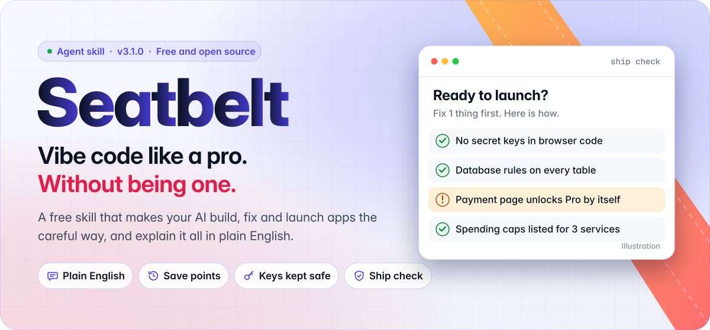
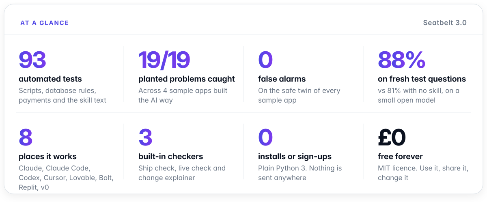
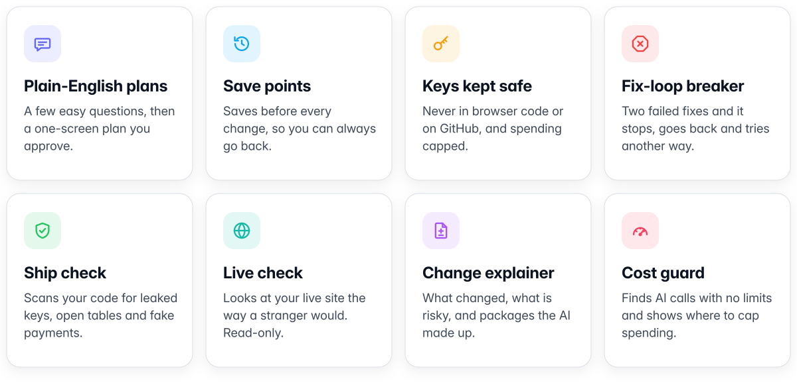
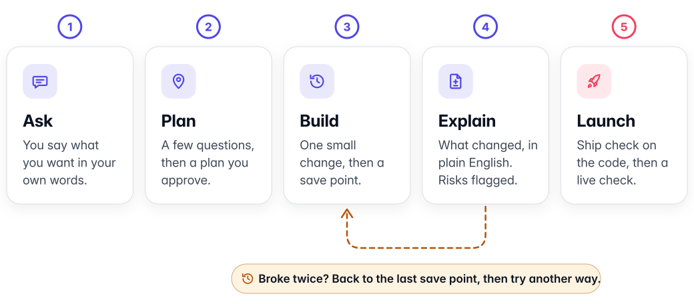
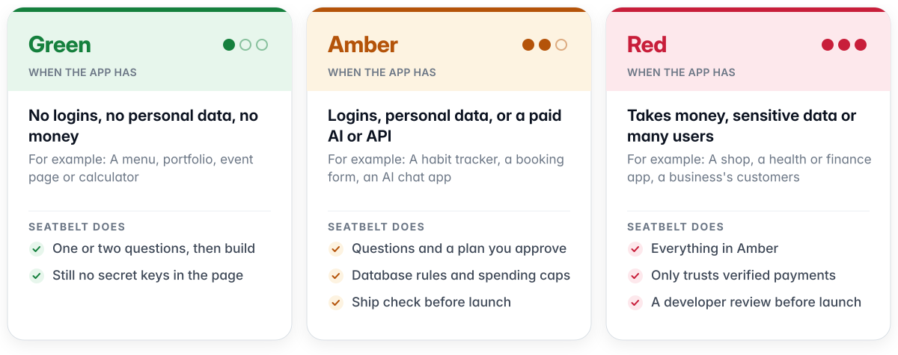
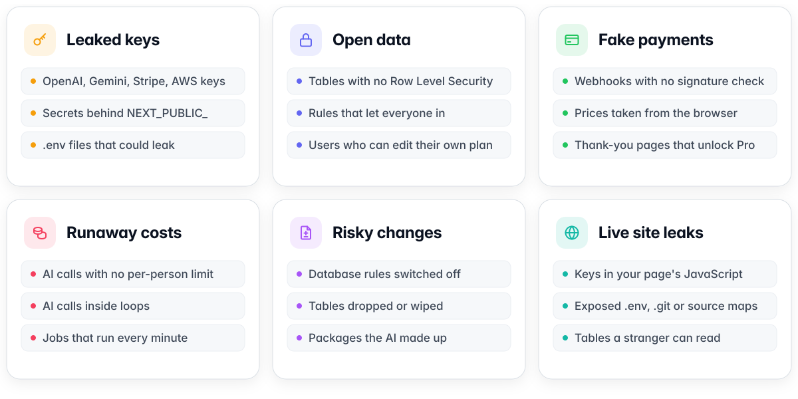
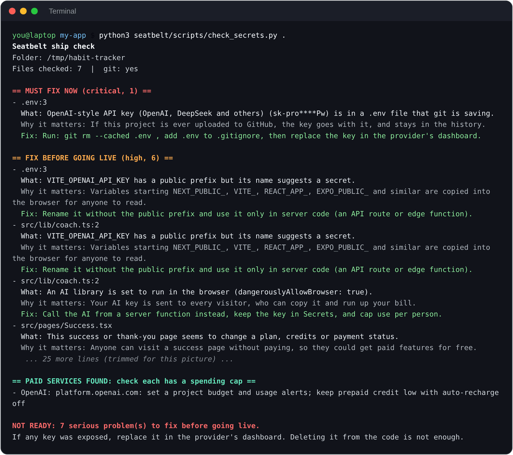
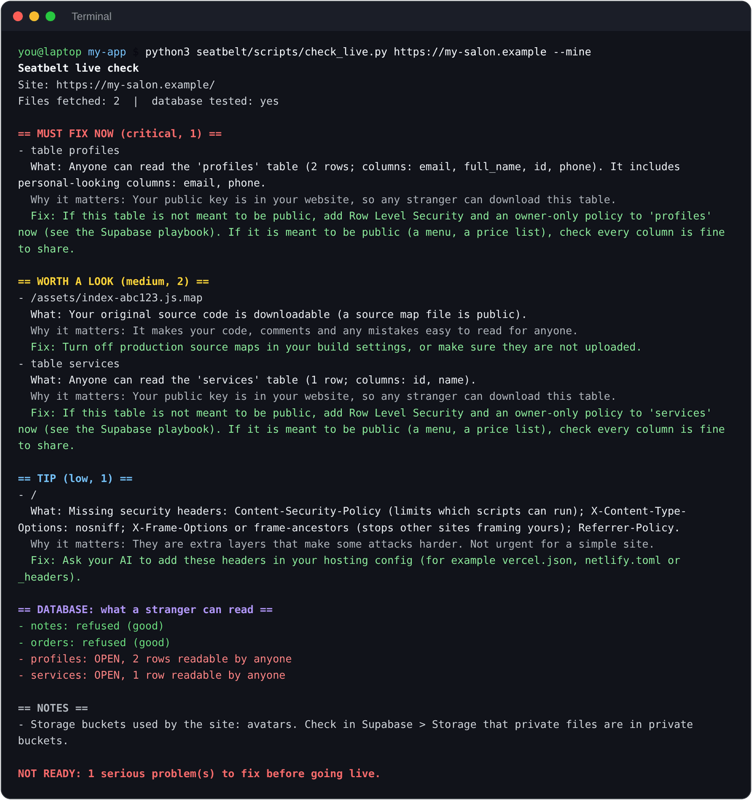
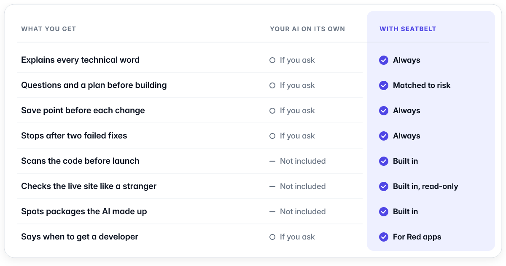
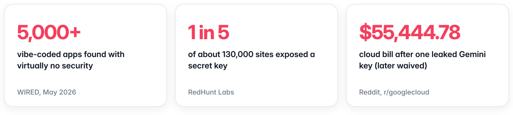

<a name="top"></a>

<picture>
  <source media="(prefers-color-scheme: dark)" srcset="assets/readme/hero-dark.svg">
  
</picture>

<p align="center">
  <a href="#install"><b>Install</b></a> &nbsp;·&nbsp;
  <a href="#what-you-get">What you get</a> &nbsp;·&nbsp;
  <a href="#how-it-works">How it works</a> &nbsp;·&nbsp;
  <a href="#what-it-catches">What it catches</a> &nbsp;·&nbsp;
  <a href="#see-it-in-action">See it in action</a> &nbsp;·&nbsp;
  <a href="#faq">FAQ</a>
</p>

<p align="center">You do not need to know what git, an API key or a database rule is. <b>Seatbelt does.</b></p>

<br>

<picture>
  <source media="(prefers-color-scheme: dark)" srcset="assets/readme/specs-dark.svg">
  
</picture>

<br>

## Install

Pick the tool you use. Every option is free.

<table>
<tr>
<td width="50%" valign="top">


Type these two lines into Claude Code:

```
/plugin marketplace add HYDERMAA/seatbelt
/plugin install seatbelt@hydermaa
```

</td>
<td width="50%" valign="top">


Any app that reads skills. One command:

```
npx skills add HYDERMAA/seatbelt
```

</td>
</tr>
<tr>
<td width="50%" valign="top">


Web or desktop chat. Three steps:

1. Download [`seatbelt.zip`](https://github.com/HYDERMAA/seatbelt/releases/latest). Do not unzip it.
2. Turn on **Settings > Capabilities > Code execution**.
3. Upload the zip under **Plugins** (once called **Customize**).

</td>
<td width="50%" valign="top">


App builders. One copy and paste:

Copy the box in [`paste-into-app-builders.md`](paste-into-app-builders.md) into your builder's always-on instructions.

</td>
</tr>
<tr>
<td width="50%" valign="top">


A lighter option for Cursor:

Copy [`.cursor/rules/seatbelt.mdc`](.cursor/rules/seatbelt.mdc) into your project's `.cursor/rules/` folder.

</td>
<td width="50%" valign="top">


Any AI that reads project files:

Copy [`AGENTS.md`](AGENTS.md) into your project's main folder.

</td>
</tr>
</table>

That is it. Your AI uses Seatbelt by itself whenever you build, fix or launch an app.

<details>
<summary><b>Step-by-step help for each tool</b></summary>

<br>

**Claude.ai**

1. Download **`seatbelt.zip`** from the [latest release](https://github.com/HYDERMAA/seatbelt/releases/latest). Do not unzip it.
2. Go to **Settings > Capabilities** and turn on **Code execution and file creation** (newer layouts call it **Create and edit files**).
3. Open **Plugins** in the sidebar and upload `seatbelt.zip` as a skill. In the older layout this was **Customize > Skills > + > Create skill > Upload a skill**.
4. Make sure Seatbelt is switched on.

Skills work on Free, Pro, Max, Ultra, Team and Enterprise plans. On Team and Enterprise, your organisation owner may need to allow skills first. [Anthropic's guide](https://support.claude.com/en/articles/12512180-use-skills-in-claude)

**Claude Code** from your terminal: `claude plugin marketplace add HYDERMAA/seatbelt` then `claude plugin install seatbelt@hydermaa`.

**By hand, for any skill-aware agent**

```bash
git clone https://github.com/HYDERMAA/seatbelt.git
mkdir -p ~/.agents/skills
cp -r seatbelt/skills/seatbelt ~/.agents/skills/
```

Restart the app if it does not appear. Claude Code reads `~/.claude/skills/` instead.

**App builders:** Lovable: **Project settings > Instructions**. Bolt: the project's **Knowledge** (Bolt can also import the whole skill under **Skills**). Replit: the `replit.md` file. v0: **+ > Instructions**.

</details>

<br>

## What you get

<picture>
  <source media="(prefers-color-scheme: dark)" srcset="assets/readme/features-dark.svg">
  
</picture>

<br>

## How it works

<picture>
  <source media="(prefers-color-scheme: dark)" srcset="assets/readme/flow-dark.svg">
  
</picture>

<br>

### Care matched to risk

Seatbelt asks what your app does, then picks the right amount of care. A portfolio gets a light touch. A shop gets the works.

<picture>
  <source media="(prefers-color-scheme: dark)" srcset="assets/readme/risk-dark.svg">
  
</picture>

<br>

## What it catches

<picture>
  <source media="(prefers-color-scheme: dark)" srcset="assets/readme/catches-dark.svg">
  
</picture>

Three single Python files do the checking. No installs, no accounts, and nothing is sent anywhere except by the optional extras.

<details>
<summary><b>Ship check</b> <code>check_secrets.py</code>: the full list</summary>

<br>

- leaked keys (OpenAI, Anthropic, Google and Gemini, Stripe, AWS, GitHub, Supabase `sb_secret_` and `service_role`, Twilio, Shopify and more), secrets behind public prefixes like `NEXT_PUBLIC_` or `VITE_`, and keys in code that runs in the browser
- `.env` files that could be uploaded, were committed in the past, or sit inside the public website folder
- Supabase tables without Row Level Security, rules switched on before the table exists, rules that let everyone in, public storage buckets and unsafe database functions
- users who can edit their own plan, credits or role
- Stripe webhooks that do not check the signature, prices taken from the browser, and success pages that grant paid features
- AI calls with no per-person limit or answer-length cap, AI calls in loops, frequent scheduled jobs, and every paid service with where to cap it
- open Firebase rules, CORS open to every website, debug mode and passwords written into code
- optionally, known-vulnerable packages (`--audit` runs `npm audit`)

```bash
python3 skills/seatbelt/scripts/check_secrets.py /path/to/your/project --report ship-report.html
```

</details>

<details>
<summary><b>Live check</b> <code>check_live.py</code>: only for sites you own</summary>

<br>

- keys inside the page and every JavaScript file it loads
- an exposed `.env` file, `.git` folder or source maps
- HTTPS and basic security headers
- with `--mine`: each Supabase table your site uses, asked for one row with the public key, exactly as a stranger could. It reports row counts and column names, never the data. Firebase too.

```bash
python3 skills/seatbelt/scripts/check_live.py https://your-site.com --mine --report live-report.html
```

</details>

<details>
<summary><b>Change explainer</b> <code>explain_changes.py</code>: before each save point</summary>

<br>

- what changed, grouped into plain-English areas (database, payments, logins, pages, packages)
- risky changes: database rules switched off, everyone let in, tables dropped, rows deleted without a filter, Stripe signature checks removed, keys or paid APIs added
- `--check-packages` looks up each new package. Missing means it may be made up.
- suggests a name for the save point

```bash
python3 skills/seatbelt/scripts/explain_changes.py . --check-packages
```

</details>

<br>

## See it in action

Real output from the real tools, run on sample apps built the way AI tools often build them.

<table>
<tr>
<td width="50%" valign="top">

**Ship check**<br>
<sub>Finds a leaked key, a fake payment page and an open table</sub>

<a href="assets/scan.png"></a>

</td>
<td width="50%" valign="top">

**Live check**<br>
<sub>Shows which tables a stranger can read, never the data</sub>

<a href="assets/live-check.png"></a>

</td>
</tr>
<tr>
<td width="50%" valign="top">

**Change explainer**<br>
<sub>Flags risky changes and a package the AI made up</sub>

<a href="assets/changes.png"></a>

</td>
<td width="50%" valign="top">

**Report you can keep**<br>
<sub>Tick things off, or share it with a developer</sub>

<a href="assets/report.png"></a>

</td>
</tr>
</table>

<sub>The live check ran against a local copy of a Supabase-style database (real PostgREST), with the address renamed for the picture.</sub>

<br>

## With Seatbelt, and without

<picture>
  <source media="(prefers-color-scheme: dark)" srcset="assets/readme/compare-dark.svg">
  
</picture>

<details>
<summary><b>What that looks like in a chat</b></summary>

<br>

<table>
<tr><th width="50%">Without Seatbelt</th><th width="50%">With Seatbelt</th></tr>
<tr valign="top"><td>

**You:** I keep getting "permission denied for table bookings".

**AI:** Easiest fix: turn off Row Level Security on the table, or run `grant all on bookings to anon`.

</td><td>

**You:** I keep getting "permission denied for table bookings".

**AI:** New Supabase tables start with no **grant**. Let us add only what logged-in people need, and keep the safety rules on:

`grant select, insert on public.bookings to authenticated;`

</td></tr>
<tr valign="top"><td>

**You:** Now login is broken too. Help.

**AI:** Let me try another fix to the login code...

</td><td>

**You:** Now login is broken too. Help.

**AI:** Let us stop changing things. First, go back to your last working save point. Then we get the exact error and make one small change at a time.

</td></tr>
</table>

<sub>Illustrative examples written for this page. The test results below use real model output.</sub>

</details>

<br>

## Why it matters

The AI does what you ask. If you do not know to ask for security, you often do not get it.

<picture>
  <source media="(prefers-color-scheme: dark)" srcset="assets/readme/stats-dark.svg">
  
</picture>

<sub>Sources: [WIRED, May 2026](https://www.wired.com/story/thousands-of-vibe-coded-apps-expose-corporate-and-personal-data-on-the-open-web/) · [RedHunt Labs](https://redhuntlabs.com/blog/echoes-of-ai-exposure-thousands-of-secrets-leaking-through-vibe-coded-sites-wave-15-project-resonance/) · [Reddit, r/googlecloud](https://www.reddit.com/r/googlecloud/comments/1noctxi/student_hit_with_a_5544478_google_cloud_bill/) · Further reading: [Canadian Centre for Cyber Security, ITSM.60.043](https://www.cyber.gc.ca/en/guidance/managing-security-risks-vibe-coding-itsm60043)</sub>

<br>

## How it is tested

| What | Result |
| --- | --- |
| **Scanner accuracy:** 4 sample apps (Lovable + Supabase, Next.js + Stripe, Firebase, Bolt + Netlify), each with planted problems and a safe twin | **19 of 19** caught, **0** false alarms |
| **Real projects:** 10 public open-source and Lovable projects | Every serious finding reviewed by hand |
| **Database, live check and payments:** real Postgres, real PostgREST and the real `stripe` library with signed test events | Passing |
| **The skill itself:** non-developer scenarios answered by a small, free open model, graded blind | Fresh questions: **88%** with v3, 80% with v2, 81% with no skill. [Details and caveats](evals/real/README.md) |

<sub>The sample apps were written by the maintainer, so they show the scanner works as designed rather than proving it catches everything. Seatbelt is a safety net, not a full security audit.</sub>

<br>

## FAQ

<details>
<summary><b>Is it free?</b></summary>
<br>
Yes, all of it. MIT licence. Use it, share it, change it.
<br><br>
</details>

<details>
<summary><b>Does it work in the Claude.ai chat, without a terminal?</b></summary>
<br>
Yes. Upload your project as a zip and ask Claude to check it. With code execution on, it can run the scanner on the zip.
<br><br>
</details>

<details>
<summary><b>Will it slow me down?</b></summary>
<br>
A little at the start of a new app: a few questions and a plan. Quick questions still get quick answers.
<br><br>
</details>

<details>
<summary><b>Do I need to know git?</b></summary>
<br>
No. Seatbelt uses it quietly if it is there and calls it "save points". If not, it makes zipped backups.
<br><br>
</details>

<details>
<summary><b>Does this make my app secure?</b></summary>
<br>
No tool can promise that. Seatbelt avoids the most common and most expensive mistakes, checks before launch, and tells you when to get a professional review.
<br><br>
</details>

<details>
<summary><b>Is the live check safe to run?</b></summary>
<br>
On your own site, yes. It only reads, like a visitor's browser, using the public key your site already gives every visitor. Do not run it on sites you do not own.
<br><br>
</details>

<details>
<summary><b>I am a developer. Is this for me?</b></summary>
<br>
Probably not. Try <a href="https://github.com/obra/superpowers">Superpowers</a> or <a href="https://github.com/addyosmani/agent-skills">Addy Osmani's agent skills</a>. Seatbelt is for everyone else.
<br><br>
</details>

<details>
<summary><b>Something is wrong or out of date</b></summary>
<br>
App builders change their menus often. Please <a href="https://github.com/HYDERMAA/seatbelt/issues">open an issue</a>.
<br><br>
</details>

<br>

<details>
<summary><b>What is inside this repo</b></summary>

<br>

```
skills/seatbelt/              the skill itself (this is what gets zipped for Claude.ai)
  SKILL.md                    the main instructions
  references/                 extra detail the AI reads only when needed
  playbooks/                  tested patterns for Supabase, Stripe, logins and more
  scripts/check_secrets.py    the ship check scanner
  scripts/check_live.py       the live site check
  scripts/explain_changes.py  the change explainer
AGENTS.md                     drop-in rules for Codex, Cursor, Bolt and others
.cursor/rules/seatbelt.mdc    drop-in Cursor rule
paste-into-app-builders.md    short text for Lovable, Bolt, Replit, v0
.claude-plugin/               lets Claude Code install it as a plugin
assets/                       pictures for this page
tests/                        tests for the scripts, skill text, SQL and Stripe patterns
evals/                        rubric, scenarios and real-model evaluation
tools/                        build and check scripts for maintainers
```

</details>

<details>
<summary><b>For maintainers</b></summary>

<br>

`python3 tools/build.py` rebuilds the Cursor rule and `dist/seatbelt.zip`; `python3 tools/check.py` validates everything; `python3 -m unittest discover -s tests` runs the tests. The SQL tests need a local Postgres (`SEATBELT_PG="host=... port=... user=..."`), the live database tests also need PostgREST (`SEATBELT_POSTGREST=/path/to/postgrest`), and the Stripe tests need the `stripe` npm package (`SEATBELT_STRIPE=/path/to/node_modules/stripe`); each is skipped otherwise. `python3 tests/corpus.py` prints the scanner accuracy table. `tools/render_terminal.py` turns real tool output into the screenshots, and `tools/readme_art/make.py` builds the graphics on this page (needs `pip install uharfbuzz fonttools` and the free Inter and Geist Mono fonts).

</details>

<br>

<a href="#top">
  
</a>
